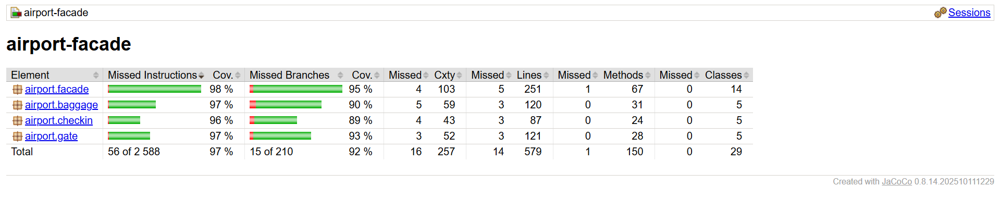
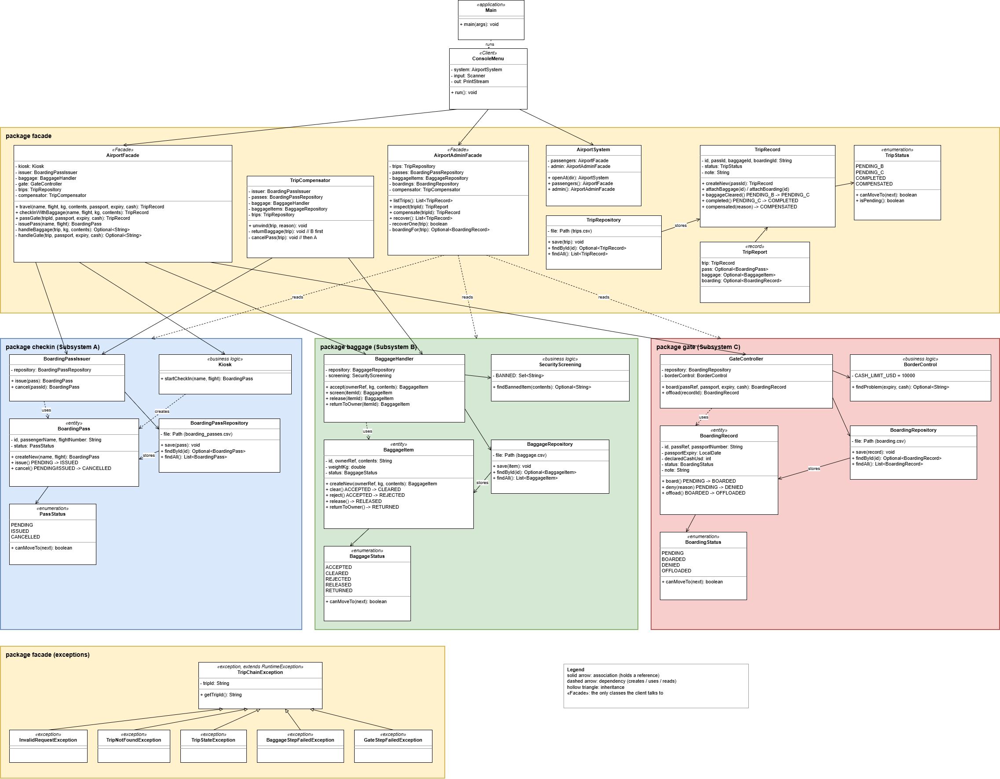

# Airport Operations: a Facade over a chain of three stages

Assignment 4 (Facade pattern), variant 1: Airport Operations.

One passenger trip is a chain of three independent subsystems:

| Stage | Subsystem | Package | What it does |
|---|---|---|---|
| A | Check-in | airport.checkin | validates the request, issues a boarding pass |
| B | Baggage | airport.baggage | accepts baggage, runs security screening |
| C | Gate | airport.gate | passport and customs control, boarding |

The chain can break in the middle, after earlier stages have already written to disk. Two facades hide this from the client:

* AirportFacade is the passenger entry point (travel, checkInWithBaggage, passGate). It runs A, B and C in order and undoes the right part of the work when a stage fails.
* AirportAdminFacade is the narrow staff entry point (listTrips, inspect, compensate, recover).

## Build, run, test

Requirements: JDK 17 or newer (developed on JDK 25) and Maven.

```
mvn -q compile exec:java
mvn test
```

The first command builds the project and starts the console demo. The second runs all tests and writes the JaCoCo coverage report to target/site/jacoco/index.html.

After mvn test, open target/site/jacoco/index.html in a browser to see the full coverage report. The summary table looks like this:



### Reset the stored data to a clean state

All state lives in the data folder (trips.csv, boarding_passes.csv, baggage.csv, boarding.csv). The standalone subsystem demos use data/standalone. To start from scratch, stop the program and delete the folder:

```
rmdir /s /q data
Remove-Item -Recurse -Force data
rm -rf data
```

The first line is for Windows cmd, the second for PowerShell, the third for macOS and Linux. The folder is created again on the next run. It is listed in .gitignore.

## Demo menu

| Choice | What it does |
|---|---|
| 1 | full trip: A, then B, then C, with your own input |
| 2 | part one only: check-in (A) and baggage (B), the trip then waits for the gate |
| 3 | part two: gate for a waiting trip (C) |
| 4 | list all trips |
| 5 | inspect one trip: pass, baggage and gate record as stored on disk |
| 6 | recover after a restart |
| 7 | undo a waiting trip by hand |
| 8 | demo: baggage fails after check-in (A is undone) |
| 9 | demo: gate fails after check-in and baggage (B is undone, then A) |
| 0 | exit |

To force a failure on demand with choice 1, use one of these inputs:

* The word knife in the baggage contents, or a weight above 30 kg: baggage failure.
* A passport expiry in the past, cash above 10000 USD, or a bad passport number: gate failure.
* An invalid flight number such as kc1: invalid request, nothing is stored.

## Architecture



The editable source is docs/airport_uml.drawio.

### The three subsystems

Each subsystem has five classes: business logic, an entity that owns its own status rules, a status enum with allowed transitions, and its own persistence gateway that writes a CSV file. The subsystems do not import each other. The only link between them is a plain text reference (ownerRef, passRef) that the facade fills in with the boarding pass id.

| | A: check-in | B: baggage | C: gate |
|---|---|---|---|
| business logic | Kiosk | SecurityScreening, BaggageHandler | BorderControl, GateController |
| entity | BoardingPass | BaggageItem | BoardingRecord |
| statuses | PENDING, ISSUED, CANCELLED | ACCEPTED, CLEARED, REJECTED, RELEASED, RETURNED | PENDING, BOARDED, DENIED, OFFLOADED |
| persistence | BoardingPassRepository | BaggageRepository | BoardingRepository |

RELEASED means an operator took the baggage off the flight inside subsystem B. RETURNED means the baggage was handed back to its owner because the trip failed. The facade uses RETURNED when it undoes stage B.

Every entity changes status only through its own methods, and each method checks the allowed transitions in the status enum. An illegal change (for example issuing a cancelled pass) throws an exception instead of corrupting data. Each subsystem can be run alone: see CheckInStandalone, BaggageStandalone and GateStandalone in the package airport.demo.

### Persisted progress of the chain

The facade keeps a journal in trips.csv. A TripRecord is saved as soon as the pass is issued. It starts as PENDING_B. When baggage is cleared it becomes PENDING_C. When the gate lets the passenger board it becomes COMPLETED. If something fails and is undone, it becomes COMPENSATED, either from PENDING_B or from PENDING_C.

The ids of the pass, baggage and gate record are written into the trip record as each stage finishes. After a restart the facade does not rely on memory. It reads the journal and the files of the subsystems to decide what to finish or undo.

### Compensation rules

| What fails | Where it is noticed | What is undone | Stored end state |
|---|---|---|---|
| invalid name or flight number | stage A, before anything is written | nothing | nothing stored, InvalidRequestException |
| baggage too heavy or invalid | stage B | A: pass CANCELLED | trip COMPENSATED, no baggage record |
| baggage rejected by screening | stage B | A: pass CANCELLED | trip COMPENSATED, baggage stays REJECTED |
| gate denies the passenger (expired passport, too much cash, bad passport number) | stage C | B first: baggage RETURNED, then A: pass CANCELLED | trip COMPENSATED, gate record DENIED (no gate record for a bad passport number) |

TripCompensator does the undo. It looks at the stored status of each item and only changes what can still be changed, so running it twice is harmless. This is what makes recovery after a crash during an undo safe.

Recovery after a restart (AirportAdminFacade.recover):

* Trip PENDING_B: the chain never got past baggage, so it is undone.
* Trip PENDING_C and the gate record says BOARDED: the trip is completed.
* Trip PENDING_C and the gate record says anything else: the trip is undone.
* Trip PENDING_C and no gate record yet: the trip keeps waiting for the gate.

The method compensate is the manual version for one trip. It refuses to touch a trip that is finished, and it refuses a passenger who is already boarded.

### Exceptions

TripChainException is the base class and carries the trip id. Subclasses: InvalidRequestException (bad input, nothing stored), BaggageStepFailedException, GateStepFailedException, TripNotFoundException and TripStateException.

## Principle of Least Knowledge: before and after

### Before

Without a facade a client has to know every subsystem, the order of the calls, the status enums of each stage, and the undo rules:

```java
Kiosk kiosk = new Kiosk();
BoardingPassIssuer issuer = new BoardingPassIssuer(passRepository);
BaggageHandler baggage = new BaggageHandler(baggageRepository, new SecurityScreening());
GateController gate = new GateController(boardingRepository, new BorderControl());

BoardingPass pass = issuer.issue(kiosk.startCheckIn(name, flight));
BaggageItem item = baggage.accept(pass.getId(), kg, contents);
if (baggage.screen(item.getId()).getStatus() == BaggageStatus.REJECTED) {
    issuer.cancel(pass.getId());
    return;
}
BoardingRecord record = gate.board(pass.getId(), passport, expiry, cash);
if (record.getStatus() == BoardingStatus.DENIED) {
    baggage.returnToOwner(item.getId());
    issuer.cancel(pass.getId());
}
```

The client must run A, B and C in this order, undo A if baggage is rejected, and undo B and then A if the gate says no. After a crash nobody knows which steps already happened.

The client talks to four subsystem classes, three entities and two status enums, and builds three repositories. That is far more than a few immediate friends.

### After

With the facade the client has one friend:

```java
AirportSystem airport = AirportSystem.openAt(Path.of("data"));
TripRecord trip = airport.passengers().travel(name, flight, kg, contents, passport, expiry, cash);
```

The client knows AirportFacade (reached through AirportSystem) and the TripRecord it gets back. Ordering, persistence and undo are the business of the facade. Failures arrive as one exception family, TripChainException.

## Tests

* JUnit 5 tests for the three subsystems and the facade package. The compensator and the status enums are exercised through them.
* AirportDesk (in src/test) is a small domain language for the tests, so they read like sentences: tripWhereBaggageHasAKnife(), tripWhereGateRefusesAnExpiredPassport(), assertBaggageIs(tripId, BaggageStatus.RETURNED), assertNothingIsSaved().
* Both compensation depths have their own tests that assert the stored end state. The restart scenario is tested too: a second AirportSystem is opened on the same folder and recover is run.
* F.I.R.S.T. in short: tests are fast (no network, no sleeping). They are independent, because each test gets its own temporary folder, so there is no shared data and no order dependence. They are repeatable, because passport dates are fixed far in the future or far in the past (only BorderControlTest uses today's date, because the rule itself is about today). They are self validating (plain assertions). They are timely: the Git history shows the test commits next to the code they cover.
  A screenshot of the summary table is in docs/coverage.png.
## Known limitations

* The pass is issued and saved before the trip record is written. A crash in that very short gap would leave an issued pass with no trip record, and recovery cannot see it.
* After a crash while a trip is PENDING_B, recovery undoes the whole trip even if baggage had already been cleared. This is deliberately cautious. The passenger simply checks in again.
* Each save rewrites the whole CSV file. That is fine for a demo, not for a large system.

## Reflection: why a Facade and not an Adapter

An Adapter makes one interface fit another that the client already expects. It is a translator. Nothing in this airport needs translating: Kiosk, BaggageHandler and GateController already have clean interfaces that a client could call directly.

The real problem is different. To take one passenger through the airport, a caller has to run three subsystems in the right order, remember what each has already written to disk, and, when screening or the gate says no, undo exactly the right part of the work. AirportFacade removes that burden. One call, travel(...), hides the ordering, and the persisted trip journal together with TripCompensator hides the undo rules. That is the intent of the Facade pattern: a simpler entry point at a higher level to a set of classes.

The facade also carries its own logic (the journal and the recovery), which an adapter would never have. And it does not lock the subsystems away: the admin facade and the standalone demos still use them directly, as the pattern allows. If one subsystem had a legacy API with different method names, an adapter could sit behind the facade to translate it, but it would not replace the facade.

The decision is not about how many classes are wrapped. It is about purpose. A Facade simplifies a complex system, and an Adapter converts an incompatible interface.

## Project layout

```
src/main/java/airport/
  checkin/   Kiosk, BoardingPassIssuer, BoardingPass, PassStatus, BoardingPassRepository
  baggage/   SecurityScreening, BaggageHandler, BaggageItem, BaggageStatus, BaggageRepository
  gate/      BorderControl, GateController, BoardingRecord, BoardingStatus, BoardingRepository
  facade/    AirportFacade, AirportAdminFacade, AirportSystem, TripCompensator,
             TripRecord, TripStatus, TripRepository, TripReport, exceptions
  demo/      ConsoleMenu and three standalone subsystem demos
  Main.java
src/test/java/airport/   tests for every package, AirportDesk
docs/                    uml.png, airport_uml.drawio, coverage.png
```